<p align="center">
  
</p>

<h1 align="center">LocalCutVideo</h1>

<p align="center">
  <b>Edit your videos. Nothing leaves your computer.</b><br />
  Auto-cut silences, Whisper subtitles, text-based editing, 16:9 → 9:16 auto-framing and MP4 export,<br />
  running 100% in the browser. No upload, no account, no server.
</p>

<p align="center">
  <a href="https://localcutvideo.mbonnici.fr"><b>localcutvideo.mbonnici.fr</b></a> ·
  <a href="CHANGELOG.md">Changelog</a> ·
  <a href="https://github.com/ImMaxence/LocalCutVideo/issues">Issues</a> ·
  <a href="LICENSE">MIT License</a>
</p>

<p align="center">
  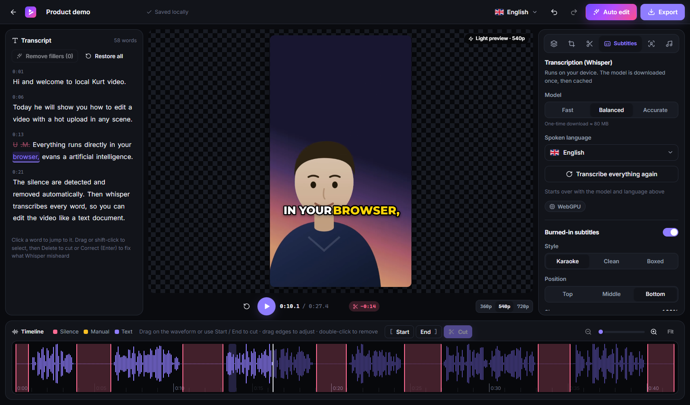
</p>

## Features

| | |
| --- | --- |
| **Auto edit** | One click: transcription, filler removal, silence cuts, face framing, smart zoom and karaoke subtitles, with good defaults. Undo in one step. |
| **Voice detection** | The auto edit asks whether someone speaks in each clip (or detects it with Whisper). Clips without voice get no subtitles and only real dead air is cut. |
| **Thumbnail maker** | Suggests the sharpest moments of the video, adds a big title with highlighted words (4 styles), color boost and reframing; downloads JPG / PNG for YouTube, Shorts or a square post. |
| **Zero upload** | The video is read in place from your disk (File System Access API). Nothing is sent anywhere. |
| **Multi-clip** | Import several takes at once: they play back to back in one project. Reorder, add or remove clips; cuts and words follow their clip. |
| **Input formats** | MP4, MOV, WebM, MKV. H.264 everywhere; HEVC (iPhone) when the browser can decode it (Chrome, or Edge with the HEVC extension). |
| **Auto-cut silences** | From the loudness (smoothed, with hysteresis) or from the transcript (robust to background noise). Rhythm presets; cuts follow the settings live. |
| **Text-based editing** | Whisper word timestamps: delete words in the transcript to cut the video. Correct misheard words or sentences. Filler-word removal. |
| **Manual cuts** | Start / End / Cut buttons on the playhead (keys I, O, X), or drag on the waveform. |
| **Speed changes** | Speed up or slow down the part between Start and End (0.25× to 4×). Voices keep their pitch (WSOLA time stretch in the export). |
| **Language detection** | The spoken language is detected automatically (Whisper language ID), or chosen by hand. |
| **Karaoke subtitles** | Word-by-word animated captions burned into the video (karaoke, clean, boxed). |
| **Output formats** | 16:9 (YouTube), 9:16 (TikTok, Reels, Shorts), 1:1, in 720p or 1080p. |
| **Auto-framing** | MediaPipe face tracking keeps the speaker in frame when going from 16:9 to 9:16. |
| **Smart zoom** | Alternating punch-in zoom on every cut (or every sentence when there is no cut). |
| **Sound** | Video volume up to 300 % with a limiter, mute, clip leveling; background music lowered automatically while someone speaks. |
| **Rotation** | Turn a video filmed sideways by 90° steps; preview, export and face tracking follow. |
| **Timeline** | Wavesurfer.js waveform with draggable, resizable cut regions; select a cut to nudge its start / end (±0.1 s) or listen to it; zoom (buttons, Ctrl + wheel); undo / redo. |
| **Light preview** | The preview renders at 360p, 540p or 720p to keep the editor smooth; the export is always full quality. |
| **Mobile editor** | A dedicated phone layout with the tools in a bottom tab bar. |
| **Fast export** | Hardware encoding with WebCodecs, MP4 muxing with Mediabunny, streamed straight to disk. |
| **Crash recovery** | Every change is auto-saved to IndexedDB; the video file is reconnected on reopen. |
| **PWA** | Installable, works offline, "Open with LocalCutVideo" for video files. |
| **5 languages** | English, French, Spanish, Italian, German. Light / dark / system theme. |
| **Legal pages** | Legal notice, privacy policy and terms of use, in the 5 languages. |

## Screenshots

| Landing (dark) | Landing (light) |
| --- | --- |
| 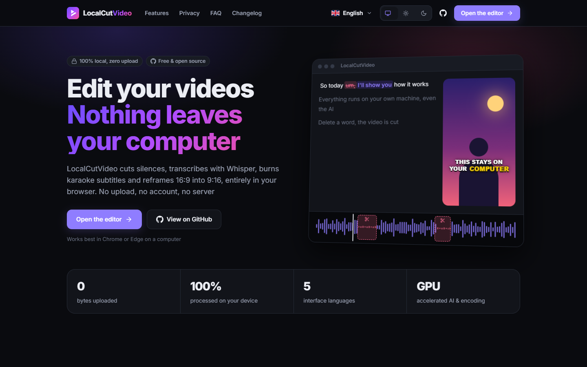 | 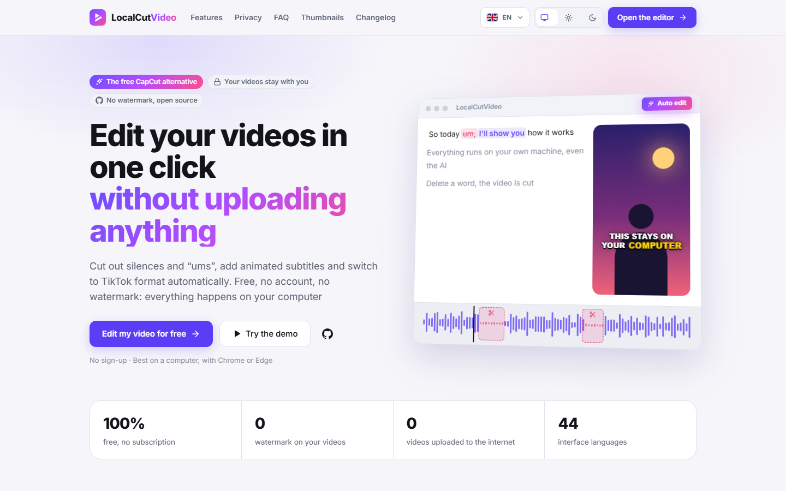 |

| Auto edit | Silence detection and cuts |
| --- | --- |
| 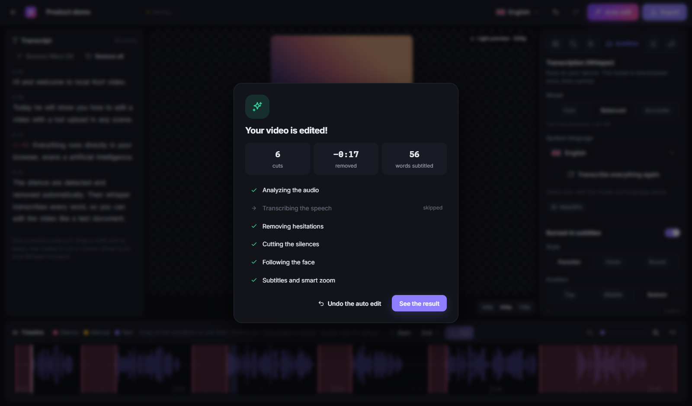 | 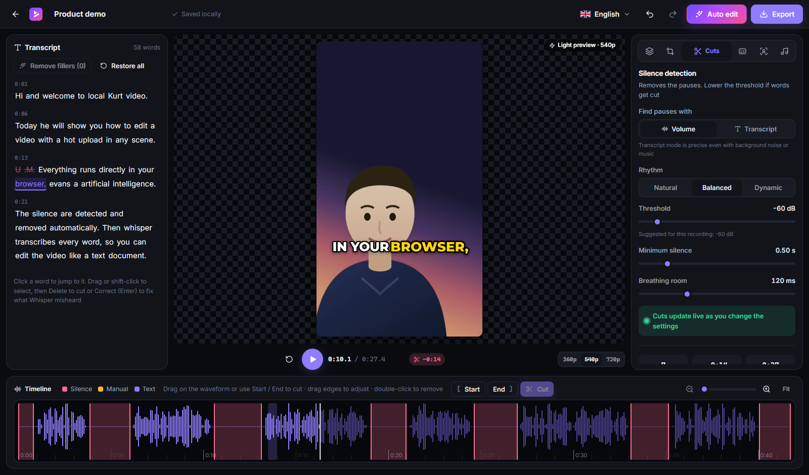 |

| Thumbnail maker | Sound |
| --- | --- |
| 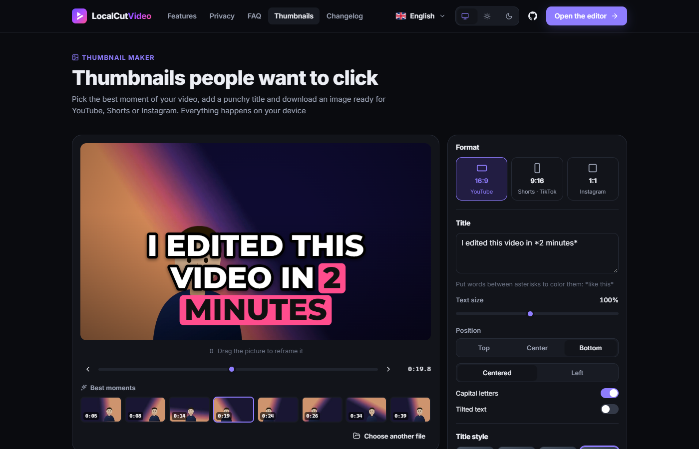 | 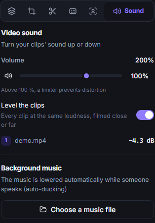 |

| Export | Changelog |
| --- | --- |
| 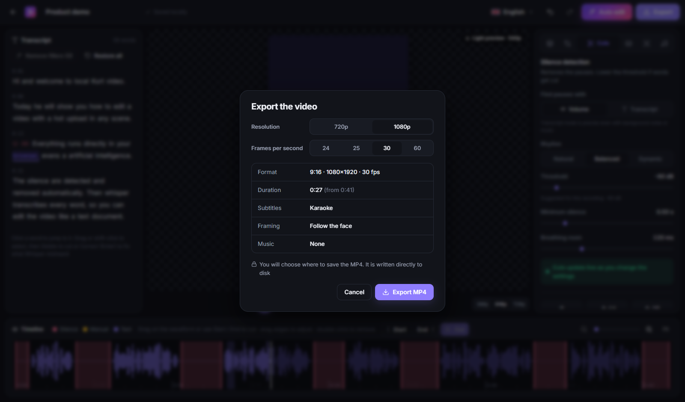 | 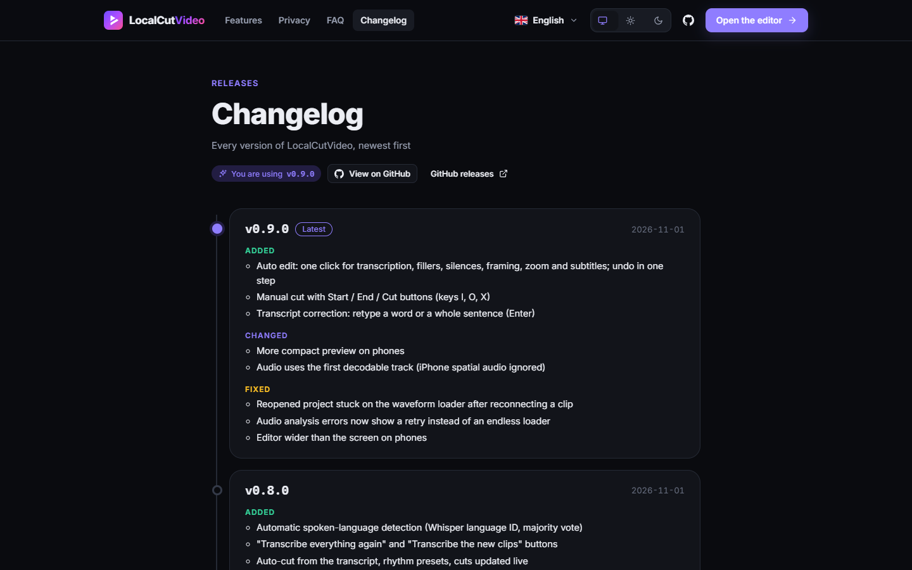 |

| Multi-clip sequence | Projects and crash recovery |
| --- | --- |
| 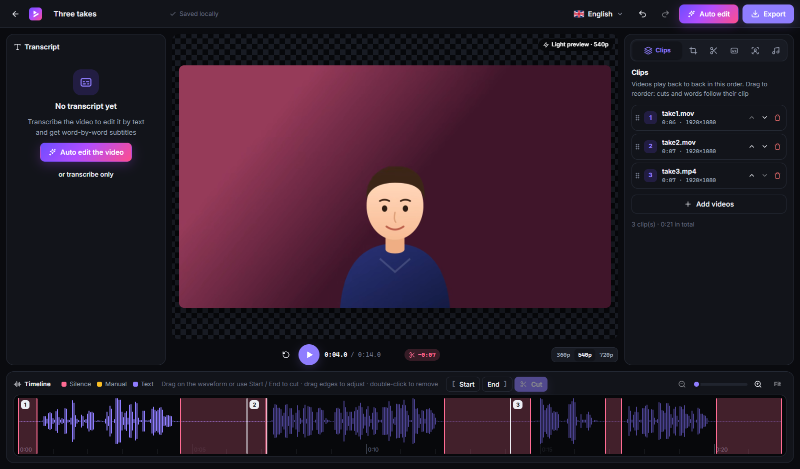 | 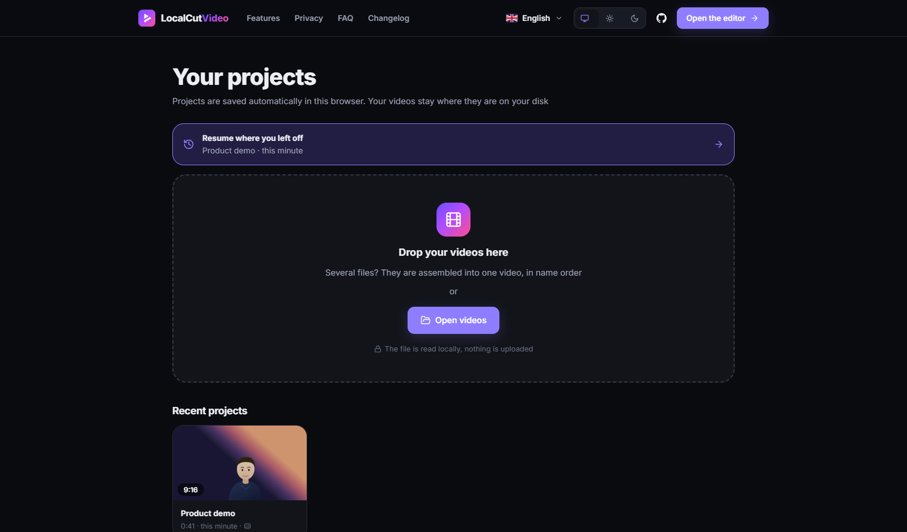 |

| Mobile editor | Mobile menu | Privacy policy |
| --- | --- | --- |
| 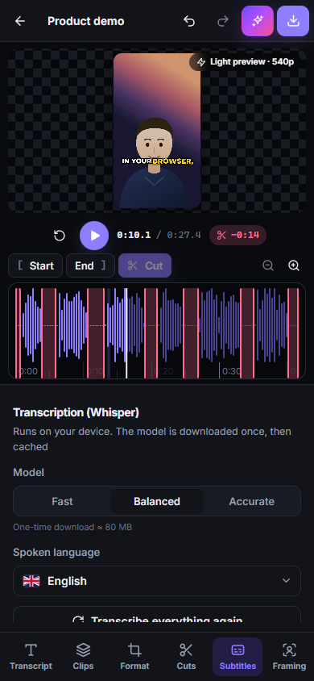 | 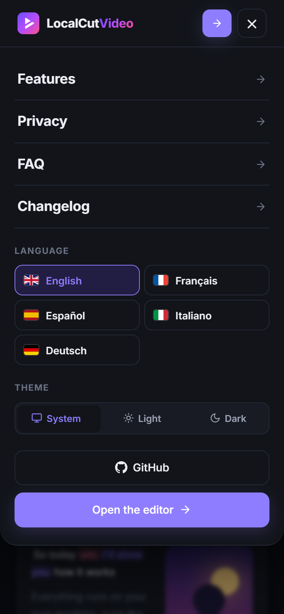 | 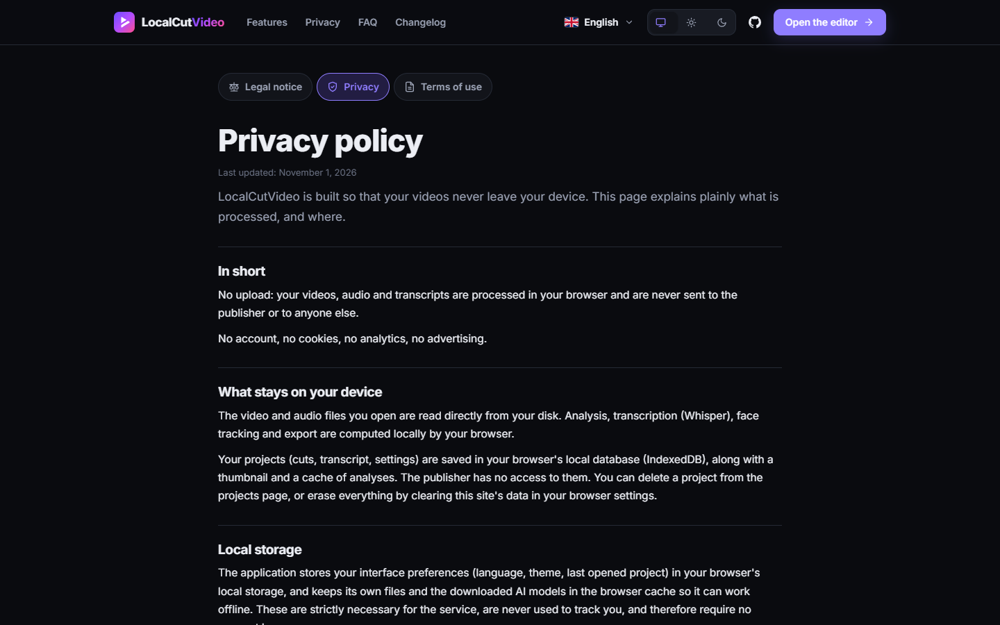 |

## How it works

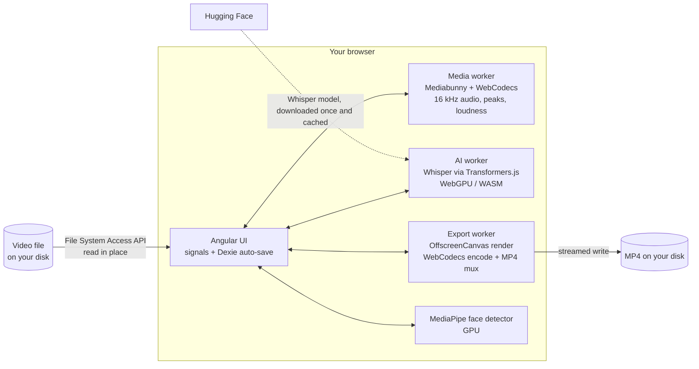

- **The project is a JSON document** (clips, cuts, words, captions, framing, music, export settings). Source files are never modified: editing is non-destructive.
- **Clips form one sequence**: every time in the project is a sequence time. Reordering or removing a clip remaps cuts, words and the face track so they stay attached to their clip (`src/app/engine/sequence.ts`).
- **The preview and the export share the same render code** (`src/app/engine/render.ts`), so what you see is what gets encoded.
- **Heavy work runs in Web Workers** so the interface never freezes: audio extraction, transcription and encoding.
- **Audio for Whisper** is decoded with WebCodecs and resampled to 16 kHz mono directly in RAM; silences are cut before transcription to avoid Whisper hallucinations.

## Privacy

- No upload, no account, no cookies, no analytics. The server keeps no access logs.
- The production server sends a strict **Content-Security-Policy**: the page can only connect to its own origin and to Hugging Face (one-time model download). You can verify it in your browser's dev tools.
- ONNX Runtime and MediaPipe binaries, fonts and the face model are self-hosted (no CDN).
- MediaPipe Tasks 1.x reports usage metrics to Google by default. These requests are dropped locally and also blocked by the CSP.
- Projects live in your browser's IndexedDB and can be deleted from the projects page.

## Browser support

| Browser | Support |
| --- | --- |
| Chrome, Edge, Opera, Brave (desktop) | Full: crash recovery with file handles, export streamed to disk, WebGPU transcription |
| Firefox | Editing and export work; the video must be re-selected after closing the tab; the export is downloaded |
| Safari (recent) | Same as Firefox; WebCodecs support depends on the version |
| Mobile | Short clips only, limited by memory |

## Tech stack

| Area | Choice |
| --- | --- |
| UI | Angular 22 (standalone components, zoneless, signals), SCSS with `light-dark()` |
| i18n | Transloco (runtime language switch), JSON files in `public/i18n` |
| Storage | Dexie.js (IndexedDB), RxJS `debounceTime` auto-save |
| Media | Mediabunny (demux / mux), WebCodecs (hardware decode / encode) |
| AI | Transformers.js + Whisper `onnx-community/whisper-*_timestamped`, MediaPipe Tasks Vision (BlazeFace) |
| Timeline | Wavesurfer.js 8 (regions + timeline plugins) |
| Workers | Comlink |
| PWA | `@angular/service-worker`, web app manifest with file handlers |
| Hosting | nginx (COOP/COEP, CSP, caching) in Docker, deployed with Coolify |

## Development

Requirements: Node.js 22.22+ or 24.15+, and Chrome or Edge to test every feature.

```bash
npm install
npm start            # http://localhost:4200 (COOP/COEP headers are set by the dev server)
npm run build        # production build in dist/localcutvideo/browser
npm run typecheck    # app + workers
```

```text
src/app/
├── core/        services: Dexie DB, file access, workers, face tracking, theme, i18n, PWA
├── engine/      framework-free logic shared with workers: project model, timeline math,
│                silence detection, ducking, framing, rendering
├── workers/     media.worker, ai.worker (Whisper), export.worker
├── editor/      editor page, store (state, auto-save, undo), preview, timeline, transcript, inspector
├── landing/     landing page
├── projects/    project list, multi-file import, crash-recovery entry point
├── changelog/   renders CHANGELOG.md
└── legal/       legal notice, privacy policy, terms of use (content in public/i18n)
```

## Deployment

The app is a static site served by nginx. The headers matter: `Cross-Origin-Opener-Policy` and `Cross-Origin-Embedder-Policy` enable multithreaded WebAssembly, and the CSP enforces the privacy promise. They are set in [`docker/headers.conf`](docker/headers.conf).

### Docker Compose (local)

```bash
docker compose -f docker-compose.yml -f docker-compose.local.yml up --build
# → http://localhost:4280
```

### Coolify

1. In Coolify, create a resource from the GitHub repository `ImMaxence/LocalCutVideo`, branch `main`.
2. Choose the **Docker Compose** build pack, with `docker-compose.yml` as the compose file.
3. Set the domain of the `web` service to `https://localcutvideo.mbonnici.fr` (container port 80).
4. Deploy. Coolify's proxy handles HTTPS; the container exposes a `/healthz` endpoint for the health check.

## Versioning

- The version comes from `package.json` and is shown in the site footer and on the `/changelog` page.
- [`CHANGELOG.md`](CHANGELOG.md) follows Keep a Changelog. It is copied into the build and rendered in the app.
- To release: bump `version` in `package.json`, add a section to `CHANGELOG.md`, tag `vX.Y.Z`.

## License

[MIT](LICENSE) © Maxence Bonnici. Third-party libraries and models keep their own licenses (Mediabunny: MPL-2.0, Transformers.js, MediaPipe and Dexie: Apache-2.0, Wavesurfer.js: BSD-3-Clause, Whisper models: MIT, Montserrat and Inter fonts: OFL).
